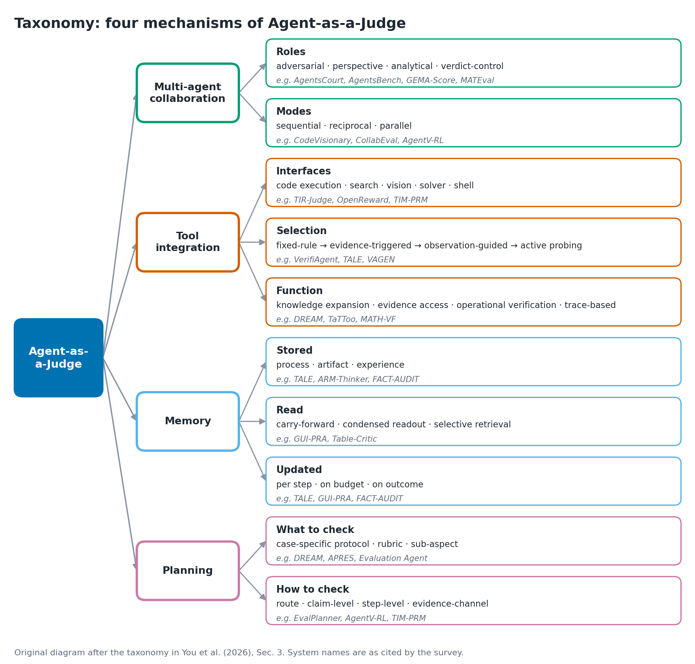
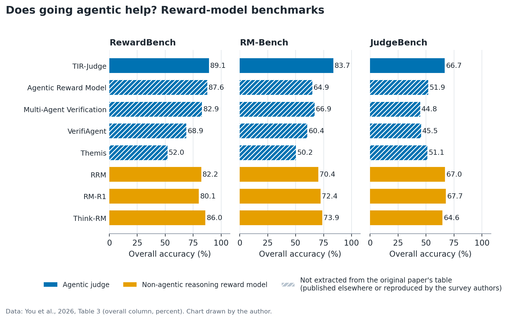
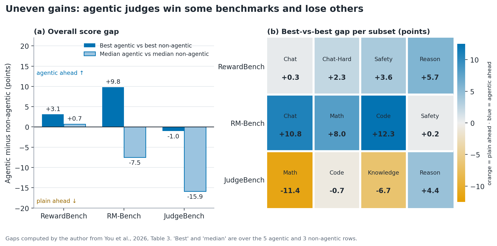

# A Survey on Agent-as-a-Judge: Short Story

CMPE 297, Fall 2026, San José State University. A short story on the survey paper *A Survey on Agent-as-a-Judge* (You et al., 2026): a Medium article, a slide deck, a talk script and reproducible figures.

**Presented by:** Pratham Rajesh

## Deliverables

| Deliverable | Link |
|---|---|
| Paper (arXiv) | [arXiv:2611.18067](https://arxiv.org/abs/2611.18067) · [PDF copy in this repo](Paper.pdf) |
| Medium article | TBD |
| Article source (Markdown) | [article/medium_article.md](article/medium_article.md) |
| Slides (SlideShare) | TBD |
| Slides (PDF / PPTX in this repo) | [PDF](slides/agent_as_a_judge.pdf) · [PPTX](slides/agent_as_a_judge.pptx) |
| Speaker notes (video script) | [slides/speaker_notes.md](slides/speaker_notes.md) |
| Video (YouTube) | TBD, see [video/README.md](video/README.md) |

## The paper in 150 words

A plain LLM judge reads a fixed packet (the output to be judged plus some instructions) and scores it. That fails when the deciding evidence is not in the packet: whether a file was really written, whether a patch passes its tests, whether a medical claim matches current guidance. The survey calls an evaluator that goes and gets that evidence an *Agent-as-a-Judge*. To qualify, it must perform at least one real checking step, and the findings must feed the verdict. The authors sort the design space into four mechanisms (multi-agent collaboration, tool integration, memory and planning), then compare published reward-model results for agentic and non-agentic judges on RewardBench, RM-Bench and JudgeBench. Their conclusion is that the gains are uneven. The survey closes with open problems: cost, reliability, safety and governance.



*Figure: the four mechanisms and their sub-types, redrawn from the survey's description.*

## Key results

Table 3 of the survey puts five agentic judges next to three non-agentic reasoning reward models. One agentic system, TIR-Judge (an 8B model with code execution in its reasoning loop), leads RewardBench and RM-Bench and is essentially tied on JudgeBench. The rest of the agentic group does not follow: the median agentic score is behind the median non-agentic score on two of the three benchmarks. The three benchmarks also give the judge two finished answers, so they only partly test evidence-seeking, which is what agentic judges are for.



*Figure: overall scores on three benchmarks. Hatched bars mark entries that were not taken from the original paper's own comparison table. Data: You et al. (2026), Table 3.*



*Figure: score gaps between agentic and non-agentic judges, overall and per subset. Gaps computed from Table 3.*

## Supporting papers

The article and slides cross-check the survey against these papers (notes in [notes/supporting_papers.md](notes/supporting_papers.md)):

- Zhuge et al., *Agent-as-a-Judge: Evaluate Agents with Agents* ([arXiv:2410.10934](https://arxiv.org/abs/2410.10934)): the original paper behind the idea, with the DevAI benchmark.
- Gu et al., *A Survey on LLM-as-a-Judge* ([arXiv:2411.15594](https://arxiv.org/abs/2411.15594)).
- Li et al., *From Generation to Judgment: Opportunities and Challenges of LLM-as-a-judge* ([arXiv:2411.16594](https://arxiv.org/abs/2411.16594)).
- Norman et al., *Reliability without Validity* ([arXiv:2606.19544](https://arxiv.org/abs/2606.19544)): a counterpoint on how much benchmark agreement tells us.
- Doğruöz et al., *Challenges and Recommendations for LLM-as-a-Judge in Multilingual Settings and for Low-Resource Languages* ([arXiv:2607.02235](https://arxiv.org/abs/2607.02235)).

Full citations are in [references.md](references.md).

## Repo map

```
.
├── README.md
├── Paper.pdf                      # the surveyed paper (CC BY 4.0)
├── article/
│   ├── medium_article.md          # the Medium article
│   └── images/                    # every figure used in the article
├── slides/
│   ├── agent_as_a_judge.pptx      # 20-slide deck with speaker notes
│   ├── agent_as_a_judge.pdf       # PDF export (for SlideShare)
│   ├── speaker_notes.md           # script for the video
│   ├── build_deck.py              # builds the deck from the figures
│   └── export_pdf.sh              # PowerPoint (macOS) to PDF export
├── figures/
│   ├── make_figures.py            # regenerates every chart and diagram
│   └── data/                      # CSVs transcribed from the papers' tables
├── notes/
│   ├── paper_notes.md             # reading notes on the survey
│   └── supporting_papers.md       # notes on the supporting papers
├── references.md
├── video/README.md
├── requirements.txt
└── LICENSE
```

## Reproduce the figures

```bash
python -m venv .venv && source .venv/bin/activate
pip install -r requirements.txt
python figures/make_figures.py
```

This rewrites the PNGs in `article/images/` from the CSVs in `figures/data/`. To rebuild the deck, run `python slides/build_deck.py`. To export the PDF on a Mac with PowerPoint, run `bash slides/export_pdf.sh`; otherwise open the .pptx in Keynote or PowerPoint and export it as PDF.

## Academic integrity

The article, slides and speaker notes are my own writing. I read the survey, then wrote from my notes rather than from its text, and I added material from the supporting papers above. Every figure was drawn from the numbers reported in the cited papers (the data is in `figures/data/`); none is a screenshot. The sections labeled as opinion are my own views, not claims of the paper. Numbers I computed myself (for example the median gaps) are marked as such. The survey's PDF is included under its CC BY 4.0 license.

## License

Code is MIT-licensed, see [LICENSE](LICENSE). The article text, slides and notes are the original work of the repository author. The surveyed paper is redistributed under CC BY 4.0, and the data in the figures belongs to the cited papers' authors.
