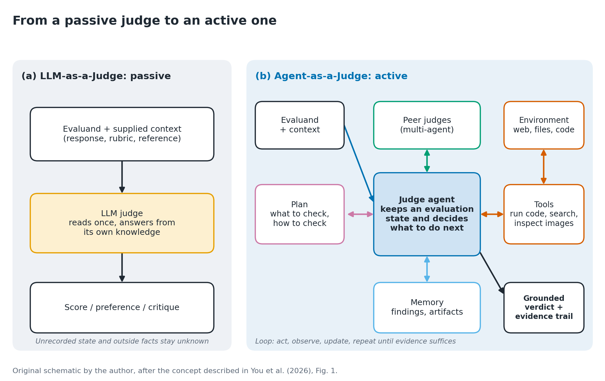
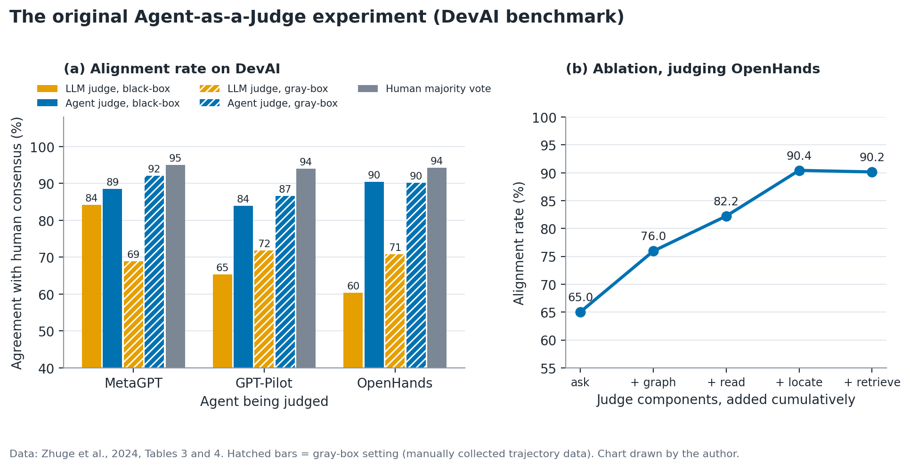
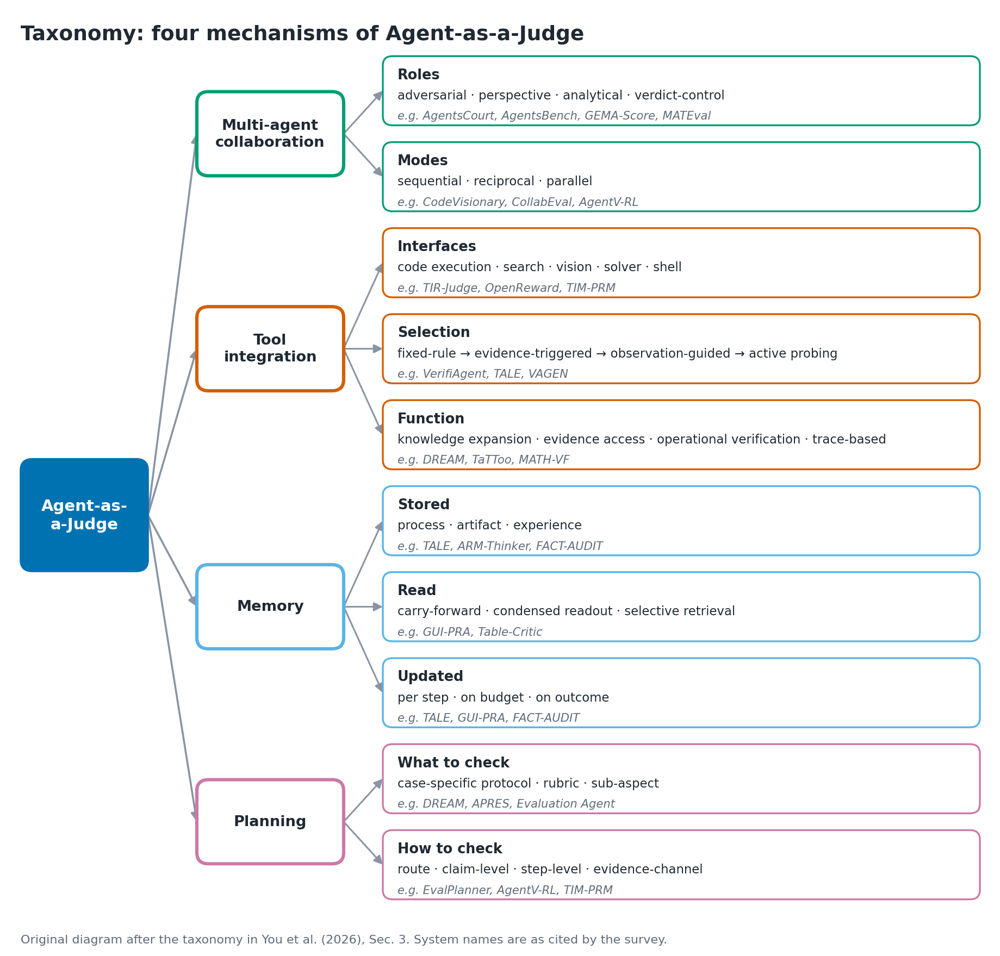
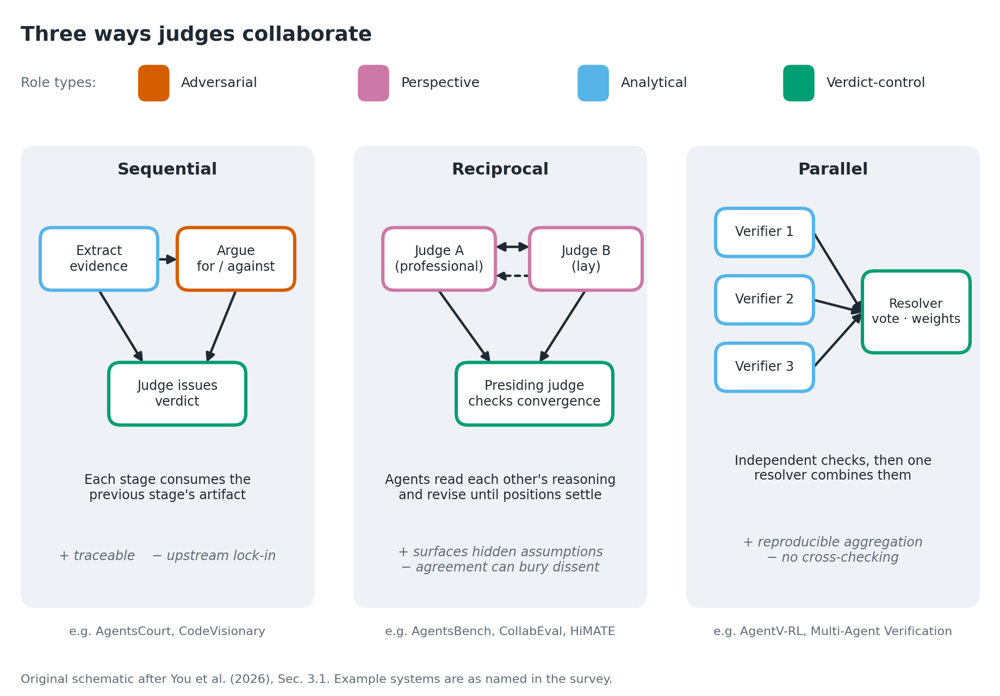
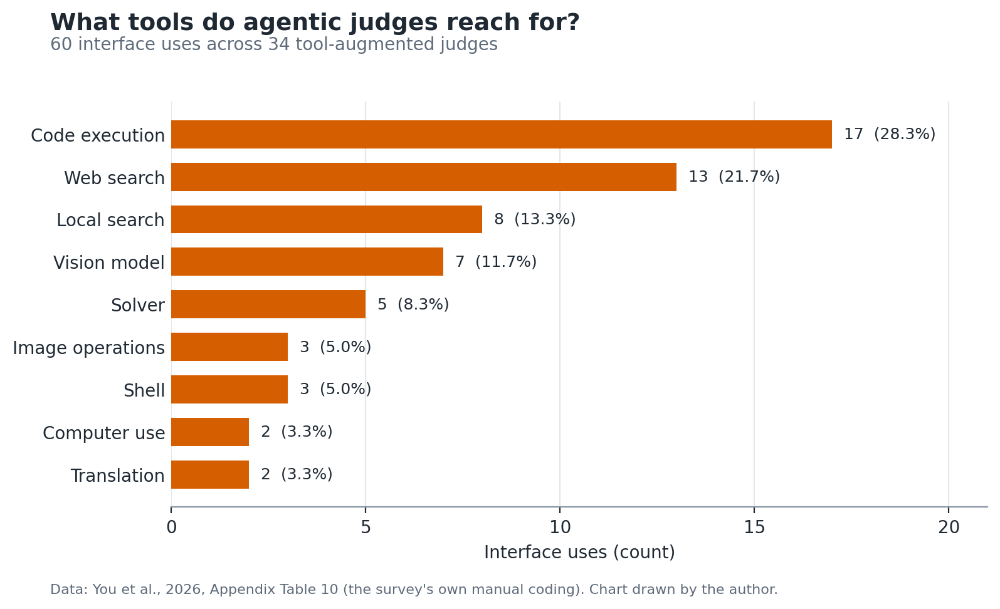
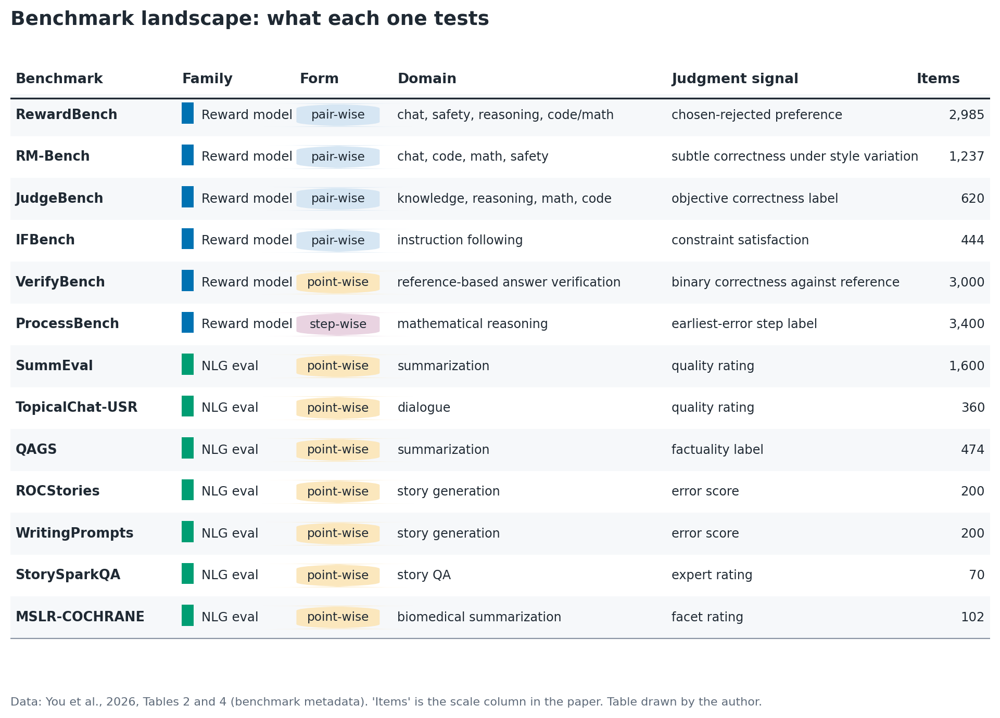
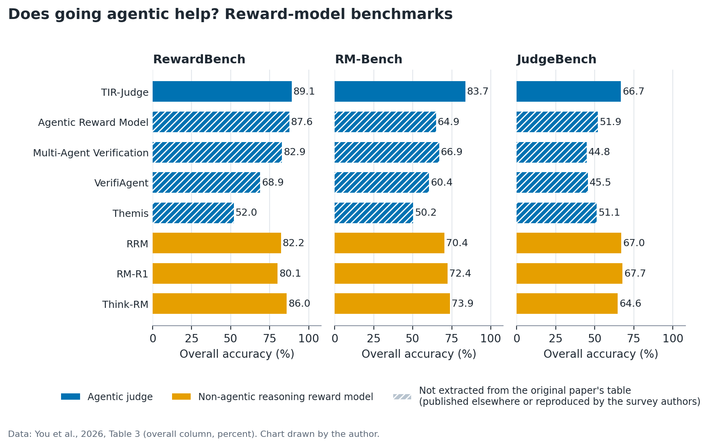
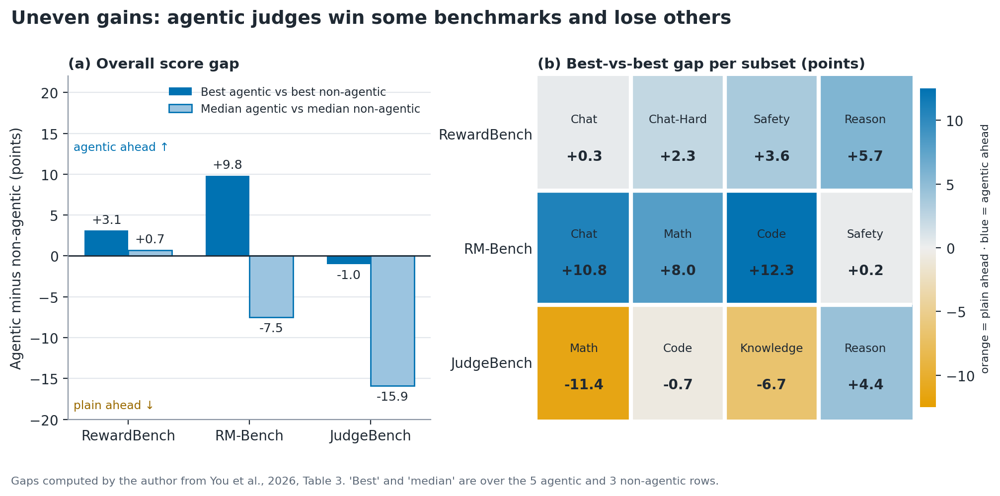
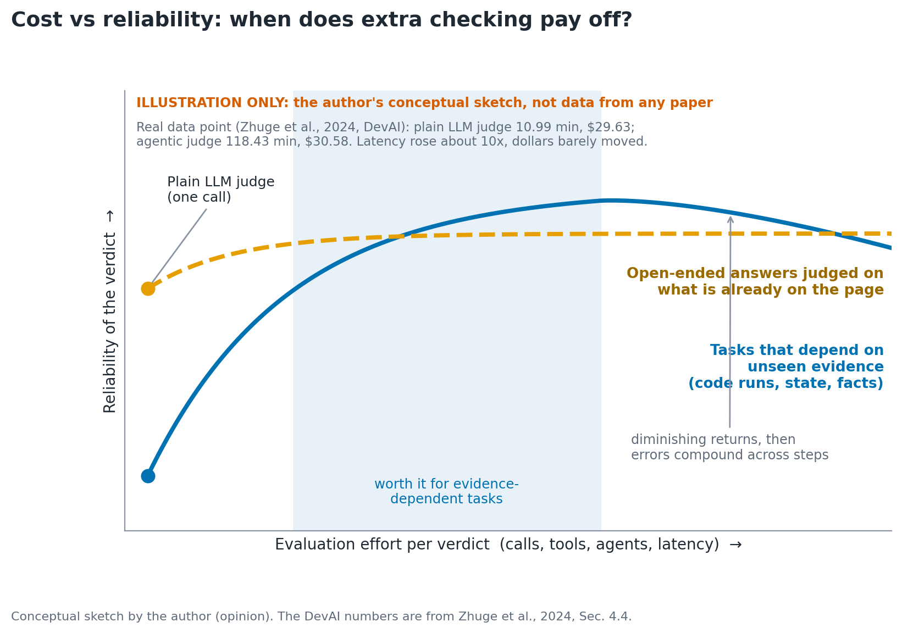

# Who Judges the Judge? A Field Guide to Agent-as-a-Judge

*What a new 2026 survey says about evaluators that can run code, search the web and remember what they found, and why the leaderboard story is less tidy than the hype.*

Picture a coding agent that finishes a task and reports: "Done. I saved the results to `output.csv`." You hand the whole transcript to an LLM judge and ask whether the task was completed. The transcript reads well. The judge says yes.

But the file was never written. A command failed quietly three steps earlier, and the agent narrated past it. The judge never had a chance to notice, because everything it could see was text, and the text was confident.

This is the gap that a November 2026 survey, [**A Survey on Agent-as-a-Judge**](https://arxiv.org/abs/2611.18067) by Runyang You, Hongru Cai and colleagues at The Hong Kong Polytechnic University and partners, sets out to organize. (On arXiv the listing shows the shorter title "Agent-as-a-Judge", but the paper itself carries the "A Survey on" prefix.) Its core claim is simple to state: some verdicts cannot be reached by reading alone, so the evaluator has to go and look.

In this post I walk through what the survey proposes, how it sorts the field, and what its leaderboard comparison really shows. I also bring in four other papers to cross-check the story, and I finish with my own opinion, which I label clearly so you can tell it apart from the paper.

## 1. LLM-as-a-Judge in two minutes

Before language models, there were two ways to grade generated text. Humans were the gold standard but slow, costly and prone to disagreeing with each other. Automatic metrics such as BLEU and ROUGE were fast, but they compare surface overlap and struggle with open-ended answers.

LLM-as-a-Judge slotted in between. You write a rubric in plain English, hand the model a response (or two to compare), and get back a score, a preference or a critique. It scales like a metric and reads like a person. Two broad surveys, [Li et al.'s "From Generation to Judgment"](https://arxiv.org/abs/2411.16594) and [Gu et al.'s "A Survey on LLM-as-a-Judge"](https://arxiv.org/abs/2411.15594), map this world. Li et al. organize it around three questions: what is being judged, how the judging is done, and how judges themselves get benchmarked. Gu et al. focus on reliability and catalogue the usual suspects: position bias (preferring whichever answer comes first), length bias (preferring longer answers) and self-enhancement bias (a model favoring its own style).

These are problems with *how* a judge reads. The agentic story is about a different problem: what the judge *can't* read at all.

## 2. Enter Agent-as-a-Judge

A classic LLM judge works from a sealed packet: the thing being judged, plus whatever instructions, rubrics or references someone put in the prompt. The survey describes two ways that packet can fall short.

1. **The decisive evidence isn't in the text.** Think of a code patch that must be run, an agent that changed files in a workspace, or a GUI task whose result lives on a screen. The transcript is only a story about what happened.
2. **The needed facts aren't in the judge's head.** Is this dosage correct under current guidance? Does this cited paper really say that? A judge without access to outside sources has to fall back on its priors, and it may even punish an answer that is right but unfamiliar.

The survey's response is to define an **Agent-as-a-Judge** as an evaluator that builds its verdict through explicit checking steps and then actually uses what those steps found. In practice that means a loop: look at the current state, pick an action (fetch a document, probe a workspace, ask a peer judge, recall a stored note), observe the result, update the state, and eventually issue a verdict. The boundary is deliberately strict. Running the same prompt five times and averaging does not qualify, and neither does giving several judges different personas while each scores independently. A plan nobody follows doesn't count either. At least one real check has to happen, and its output has to feed the verdict.

*Figure 1. A passive judge reads once and answers; an agentic judge keeps state and goes to get what is missing. Original schematic by the author, after the concept in You et al. (2026).*

The idea predates the survey. [Zhuge et al. (2024)](https://arxiv.org/abs/2410.10934) introduced the name and the first benchmark for it, **DevAI**: 55 realistic AI-development tasks carrying 365 hierarchical requirements. They used an agentic judge, with modules that read files, locate relevant code and ask whether a requirement holds, to grade three code-writing agents. Against a human-majority reference, the agentic judge agreed on about 90% of requirements for the OpenHands agent in the black-box setting, while a plain LLM judge agreed on about 60%. That gap is what started the subfield.

*Figure 2. The original experiment. Left: agreement with human consensus. Right: adding components one by one lifts alignment from 65% to about 90%, then stops helping. Data: Zhuge et al. (2024), Tables 3 and 4.*

The ablation on the right is worth a pause. Giving the judge a way to *locate* the files relevant to each requirement produced the last big jump, from about 82% to about 90%. A later "retrieve" module added nothing in that setting. More machinery is not automatically better; the machinery has to match what the judge is missing.

## 3. The taxonomy: four mechanisms

The survey's main organizing move is to ask not "what task is being judged?" but "how is the checking process built?" It finds four building blocks, which compose freely.

*Figure 3. The four mechanisms and what each one decides. Original diagram after the survey's taxonomy; example systems are those the survey cites.*

### Multi-agent collaboration

Here several evaluators share the work. The survey sorts the roles they play into four families: **adversarial** (raise objections, cross-examine), **perspective** (read the same case through different expertise), **analytical** (turn the raw material into something checkable, such as extracting entities or formalizing a proof) and **verdict-control** (merge opinions, decide when to stop). One interesting finding from the authors' manual coding of 24 papers is that a role *name* tells you little about its implementation. A "critic" might be a persona prompt, a scripted workflow step, a rule-based controller or a tool-using component.

How they cooperate comes in three modes:

- **Sequential**: each stage consumes the previous stage's output. In the legal system AgentsCourt, for example, plaintiff and defendant arguments are produced first and then feed the decision stage. You gain traceability and risk upstream lock-in, since a bad early artifact poisons every later step.
- **Reciprocal**: agents read each other's reasoning and revise, as in AgentsBench's professional and lay judges. This can expose hidden assumptions, but the group can also talk itself into a comfortable and wrong consensus.
- **Parallel**: independent assessments are combined by a resolver. Multi-Agent Verification, for example, has separate judges check separate aspects and then sums their approvals.

*Figure 4. The three collaboration modes with their typical strengths and risks. Original schematic after You et al. (2026), Sec. 3.1.*

### Tool integration

Tools are how a judge touches the world. The survey hand-coded 34 tool-using judges and counted 60 interface uses. Code execution leads, followed by web search, then local search over stored documents.

*Figure 5. What tools agentic judges use. Data: You et al. (2026), appendix Table 10.*

The more interesting axis is how a judge decides *when* to use a tool, which the survey lays out as a ladder of increasing autonomy. At the bottom are fixed rules (a math question goes to a solver). Next comes evidence-triggered use, where the judge reasons alone until it notices its evidence is thin and only then searches. Above that is observation-guided use, where one tool's output shapes the next call. At the top is active probing, where the judge creates new evidence by running a test or acting in an environment.

### Memory

Memory is the least developed of the four. The survey frames it as a write, manage and read loop and distinguishes three kinds: *process* memory (a running scratchpad of queries and evidence within one evaluation), *artifact* memory (indexed crops, pages or reports to reopen later) and *experience* memory (reusable failure cases or critique templates across evaluations). Its observation is that most agentic judges only keep the first kind. Few curate anything that carries over between cases, even though memory is a heavily studied topic for agents in general.

### Planning

Planning makes the checking procedure explicit. The survey splits it into *what to check* (deriving case-specific fact checks or a custom rubric before judging, as DREAM does) and *how to check* (writing a route first, as EvalPlanner does, or breaking a solution into atomic claims and verifying each, as AgentV-RL does). Its timeline suggests planning energy has recently shifted toward building atomic, individually verifiable criteria before any scoring happens.

## 4. The leaderboard: does going agentic actually help?

This is the part I found most useful, because the survey does something unusual for a survey: it consolidates published numbers and fills the gaps by running released code for several agentic judges, so that eight systems appear on the same three benchmarks.

First, what the benchmarks are. All three are pairwise: the judge sees two answers and must pick the better one.

- **RewardBench** (2,985 pairs) covers chat, safety, reasoning and code or math, with chosen-versus-rejected preference labels.
- **RM-Bench** (1,237 pairs) tests whether a judge notices subtle correctness differences even when the style varies.
- **JudgeBench** (620 pairs) uses objectively checkable answers across knowledge, reasoning, math and code.

*Figure 6. The benchmark landscape the survey catalogs. Reward-model suites are mostly pairwise; the NLG ones are almost all point-wise ratings. Data: You et al. (2026), Tables 2 and 4.*

Now the comparison. The five agentic judges are TIR-Judge, Agentic Reward Model, Multi-Agent Verification, VerifiAgent and Themis. They are set against three non-agentic reasoning reward models: RRM, RM-R1 and Think-RM.

*Figure 7. Overall scores from the survey's Table 3. Hatched bars are entries not taken from the original paper's own comparison table: they were either published elsewhere or filled in by the survey authors, and the paper does not flag which. Chart drawn by the author.*

Three things stand out when you read it carefully.

**One agentic system carries the headline.** TIR-Judge, an 8B model that integrates code execution into its reasoning, tops RewardBench (89.1) and RM-Bench (83.7) and sits essentially tied for first on JudgeBench (66.7, against 67.7 for RM-R1). Its best-versus-best advantage over the strongest non-agentic model is +3.1, +9.8 and −1.0 points on the three benchmarks.

**The rest of the agentic group does not follow.** Take the median agentic score against the median non-agentic score (my own arithmetic from the survey's table) and the picture flips on two of three benchmarks: +0.7 on RewardBench, −7.5 on RM-Bench and −15.9 on JudgeBench. Themis, a tool-augmented 7B judge, scores between 50 and 52 on all three benchmarks, which is close to what a coin flip would give on a two-way choice.

**Even the winner wins unevenly.** Break the gaps down by subset and you get a patchy map. TIR-Judge leads big on RM-Bench chat, math and code but only ties on its safety subset, and on JudgeBench's math subset the non-agentic RRM beats the best agentic entry by 11 points.

*Figure 8. Uneven gains. Left: overall gaps; right: per-subset best-versus-best gaps (blue favors agentic, orange favors plain). Gaps computed by the author from You et al. (2026), Table 3.*

The authors' own reading is measured: there is no uniform agentic advantage, and strong reasoning-trained reward models do well on fixed answer pairs. They also make a subtler point that I think is the real takeaway. These three benchmarks hand the judge two finished answers. They test preference and reasoning, not the thing agentic judges are *for*, which is gathering evidence the packet lacks. So a flat result here doesn't show that tools don't help; it shows the exam doesn't ask the question. The survey's call is for dedicated agentic benchmarks that report evidence-access conditions and how often the judge abstains.

### The techniques doing the work

A few of the top systems are worth a closer look, described as the survey describes them:

- **TIR-Judge** puts code execution inside the reasoning loop. It is the survey's example of operational verification: turn "this looks plausible" into a failed check or a passed one.
- **Multi-Agent Verification** (run here on Qwen3-8B) splits verification into aspects, lets separate judges approve or reject each, and adds up the approvals with no discussion between them. It is the parallel mode in its purest form, and it is strongest on RewardBench's Chat-Hard subset (80.2, ahead of every other row there).
- **Agentic Reward Model** keeps a conventional reward model (ArmoRM-Llama3-8B) as its base and adds verification modules for correctness signals around it, so it is a hybrid rather than a pure agent. Note the footnote in the survey that those modules use other models internally, which makes cost comparisons tricky.

NLG evaluation, the other half of the survey's evaluation section, has no comparable leaderboard. Results there are reported dataset by dataset (SummEval, TopicalChat-USR, QAGS and story-generation sets), mostly for debate-style judges like ChatEval, so I won't pretend there is a clean ranking to show.

## 5. Where this gets used

The survey's application map separates general domains from professional ones. In the general group: math and code (execution and solver checks), fact-checking (retrieval plus a check that the stated justification matches the evidence), conversation (simulated users and tracked state) and multimodal work (zooming into image regions, asking targeted visual questions). In the professional group the stakes and requirements rise. Medicine needs role-specialized and tool-assisted scoring because errors are safety-sensitive. Law uses adversarial debate and deliberation so a plausible verdict doesn't ignore opposing arguments. Finance leans on logic extraction and trajectory audits. Education needs consistent rubrics and gradable evidence.

A common thread: the judge matters most exactly where the right answer depends on something outside the page.

## 6. Open problems

The survey closes with four worries, and none of them is cosmetic.

- **Cost and latency.** Every extra action adds time, and the costs compound when later checks depend on earlier results. That makes online moderation and reinforcement-learning feedback loops hard to serve.
- **Process reliability.** A judge can fail in the middle: target the wrong claim, retrieve weak evidence, misread a tool's output, or let a group converge on a wrong answer. Memory can then carry the mistake forward. A verdict can look well supported while its evidence trail is flawed.
- **Safety and control.** Search engines, code runners and databases give a judge a bigger attack surface: prompt injection, tool misuse and side effects. When verdicts become reward signals, a systematic judging error can be amplified by training.
- **Privacy and governance.** Persistent evaluation memory may hold user data, so rules are needed for what is stored, for how long, and who can reuse it.

## 7. My two cents

*Everything above summarizes the papers. This section is my opinion.*

**The "who judges the judge?" problem moves up a level instead of going away.** An agentic judge is a system with plans, tools and memory, and every one of those can fail quietly. The survey says as much: a verdict can look well grounded while the trail underneath it is broken. So adopting an agentic judge means committing to evaluate the evaluator's process, not just its final answer. That's more work, not less.

**Benchmark agreement is a weaker signal than it looks.** The paper's evidence leans on the same three pairwise benchmarks, so I went looking for how stable such comparisons are. [Norman, Rivera and Hughes (2026)](https://arxiv.org/abs/2606.19544) audited 21 judges on MT-Bench, JudgeBench and RewardBench and found that judge rankings can shift by up to 14 positions from one benchmark to another, and that exact-match agreement overstates quality by 33 to 41 percentage points compared with a chance-corrected kappa on MT-Bench. They also report judges with very high test-retest consistency that still show strong position bias. If rankings move that much, a three-point edge in Table 3 deserves a shrug, and the survey's own caution about uneven gains reads as the more honest summary.

**Validation is thin outside English.** A [2026 analysis of ACL Anthology papers](https://arxiv.org/abs/2607.02235) found that only 33 of 650 papers mentioning LLM-as-a-judge focused on multilingual or low-resource settings, with a tendency to over-trust the judge and to rely on a single judge model. Agentic judges could help here (the survey cites a multilingual fact-checking system), but the validation habit has to come first.

**Cost: the evidence is more interesting than my prior.** I expected a tool-using judge to be many times more expensive than one model call. The only hard numbers I could verify come from the original DevAI study: the agentic judge took about 118 minutes and cost about $30.58, while the plain LLM judge took about 11 minutes and cost about $29.63. So in that setup, time rose roughly tenfold while dollars barely moved. That is one benchmark with one judge design, so I wouldn't generalize it, but it suggests latency may bite before the invoice does. Figure 9 is my own conceptual sketch of the trade-off, not data.

*Figure 9. Illustration only, by the author: not drawn from any paper's data. The DevAI numbers in the note are from Zhuge et al. (2024), Sec. 4.4.*

**Practical advice for teams.** If the answer can be judged from what is on the page (tone, helpfulness, summary quality), start with a well-prompted plain judge, with swapped answer order to limit position bias, and measure its agreement with humans first. Reach for agentic machinery when the verdict depends on something the page can't show: whether code runs, whether a file or database really changed, whether a cited fact holds. Add the simplest tool that fills the specific gap (execution or retrieval, the two most common ones) before adding debate or memory. And log the evidence trail, because that is what you will audit when the judge is wrong.

**What I'd like to see next.** Benchmarks built to *require* evidence-seeking, where a judge without tools can't succeed, that report cost and abstention alongside accuracy. And more work on the memory axis, where the survey finds so little.

## 8. Key takeaways

- A fixed-context LLM judge can't verify what isn't in its packet; an Agent-as-a-Judge goes and gets the evidence, and its findings must actually feed the verdict.
- The survey sorts the design space into four building blocks: planning, memory, tools, and teams of judges.
- Code execution and search dominate tool use; memory across cases is the least developed piece.
- On three shared reward-model benchmarks, gains are uneven: one agentic system (TIR-Judge) leads, but median agentic scores trail the non-agentic baselines on two of the three benchmarks.
- Those benchmarks hand the judge finished answers, so they only partly measure evidence-seeking; dedicated agentic benchmarks are still missing.
- Costs, process reliability, safety and governance are open problems, and the evaluator now needs evaluating too.

## References

1. Runyang You, Hongru Cai, Caiqi Zhang, Qiancheng Xu, Meng Liu, Tiezheng Yu, Yongqi Li, Wenjie Li. *A Survey on Agent-as-a-Judge.* arXiv:2611.18067, 2026. https://arxiv.org/abs/2611.18067
2. Mingchen Zhuge et al. *Agent-as-a-Judge: Evaluate Agents with Agents.* arXiv:2410.10934, 2024. https://arxiv.org/abs/2410.10934
3. Jiawei Gu et al. *A Survey on LLM-as-a-Judge.* arXiv:2411.15594, 2024. https://arxiv.org/abs/2411.15594
4. Dawei Li et al. *From Generation to Judgment: Opportunities and Challenges of LLM-as-a-judge.* arXiv:2411.16594, 2024. https://arxiv.org/abs/2411.16594
5. Justin D. Norman, Michael U. Rivera, D. Alex Hughes. *Reliability without Validity: A Systematic, Large-Scale Evaluation of LLM-as-a-Judge Models Across Agreement, Consistency, and Bias.* arXiv:2606.19544, 2026. https://arxiv.org/abs/2606.19544
6. A. Seza Doğruöz et al. *Challenges and Recommendations for LLM-as-a-Judge in Multilingual Settings and for Low-Resource Languages.* arXiv:2607.02235, 2026. https://arxiv.org/abs/2607.02235
7. Companion reading list for the survey: https://github.com/ModalityDance/Awesome-Agent-as-a-Judge

*Figures were drawn from the numbers reported in the papers above; all figures and the text are my own work. Results belong to the papers' authors.*
